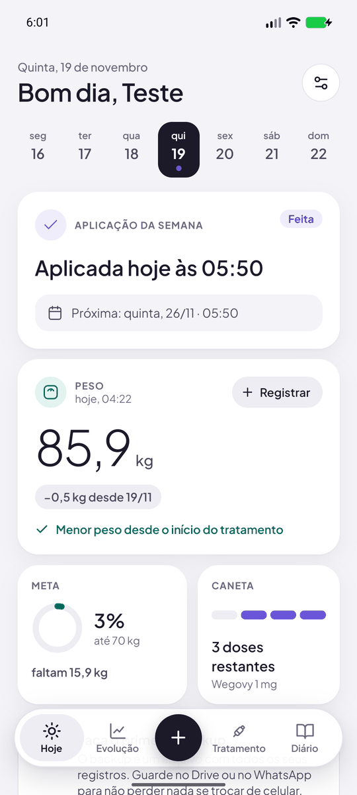
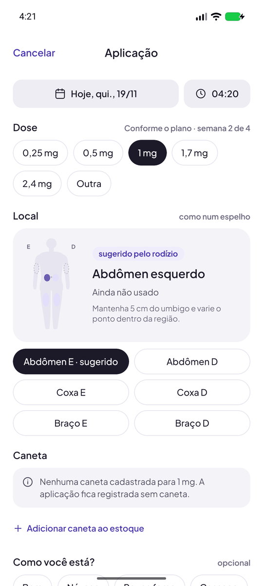
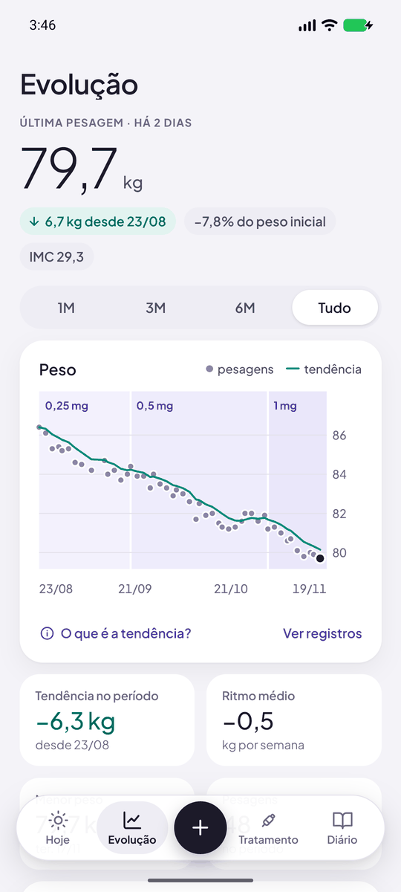
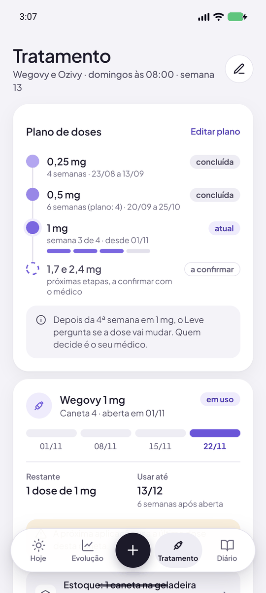
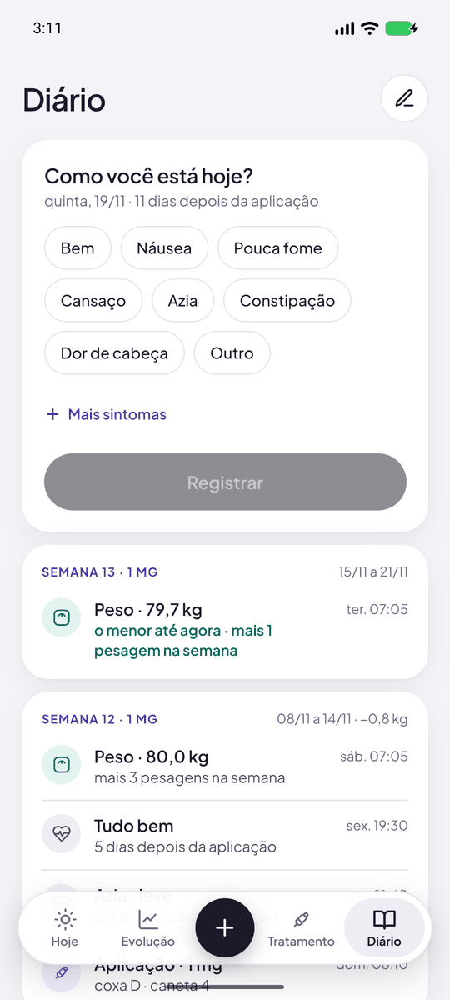
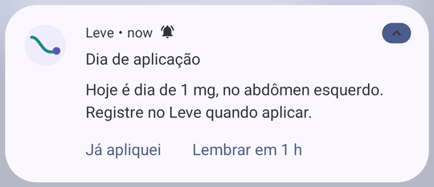
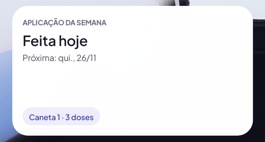

# Leve

App Android para acompanhar o tratamento com canetas de semaglutida (Wegovy, Ozivy, Ozempic e outras) e a evolução do peso. Ele registra as aplicações, lembra do dia certo, cuida do rodízio dos locais e do estoque de canetas, e mostra a evolução do peso fase a fase. Funciona offline, não tem conta nem login, e os dados ficam só no celular.

> O Leve registra e lembra. Não substitui orientação médica e nunca recomenda nem muda dose: ele segue o plano que a pessoa cadastra a partir da prescrição.

**Status:** versão 1.0.0-rc.1, em homologação. Android 8.0 ou mais novo, instalado pelo APK (não está na Play Store).

<p align="center">
  
  
  
  
  
</p>
<p align="center"><sub>Capturas com dados de teste.</sub></p>

## Para que serve

Quem usa a caneta semanal precisa lembrar do dia da aplicação, da dose (que sobe por fases), do local da última aplicação, de quanto resta na caneta e de quando comprar a próxima. E ainda acompanhar o peso, que oscila de um dia para o outro. O Leve junta tudo isso num app só, pensado para quem não é da área de tecnologia: registrar leva segundos, e a evolução se entende num relance.

É um projeto pessoal, feito para uso em casa.

## O que ele faz

**No dia a dia**
- **Hoje:** a aplicação da semana (próxima, feita ou não registrada), o último peso, a meta, a caneta em uso e avisos (comprar caneta, marcos de peso, platô, backup).
- **Registrar aplicação:** a dose do plano já vem marcada, o local é sugerido pelo rodízio num mapa do corpo e a caneta em uso é descontada sozinha. Se já houver uma aplicação há menos de 3 dias, o app avisa.
- **Lembretes:** no dia e na hora do plano, com um reforço se a aplicação não for registrada. Na própria notificação, **Já apliquei** registra sem abrir o app (também com o app fechado) e **Lembrar em 1 h** adia o lembrete.
- **Peso, medidas e fotos:** pesagem livre pelo teclado, medidas do corpo (cintura, quadril e outras) e fotos de progresso guardadas fora da galeria.

**No acompanhamento**
- **Evolução:** gráfico do peso com a linha de tendência (que filtra a oscilação do dia a dia) e as fases de dose, ritmo por semana, IMC opcional e a projeção da data da meta.
- **Tratamento:** plano de doses por fases, canetas e estoque (doses restantes, validade depois de aberta, aviso de compra), calendário, rodízio dos locais, histórico e custo do tratamento.
- **Diário:** sintomas e notas numa linha do tempo por semana, com os padrões que aparecem nos registros (por exemplo, "náusea costuma aparecer 1 a 2 dias depois da aplicação").

**Nos dados**
- **Primeiros passos:** quem já está em tratamento informa o início e as fases, e o app monta o histórico das aplicações passadas.
- **Backup** num arquivo só, com as fotos, lembrete mensal e restauração.
- **Relatório em PDF** para levar à consulta e **planilhas CSV**.
- **Balança inteligente** pelo Health Connect: o app importa as pesagens (só leitura).
- **Widget** de tela inicial com a próxima aplicação e a caneta, sem mostrar o peso.
- Tema claro e escuro.

<p align="center">
  
  
</p>

## Privacidade

- Sem conta, login, servidor ou analytics. Os dados ficam num banco SQLite dentro do app.
- O app não faz chamadas de rede. O Health Connect é usado só para ler o peso.
- O backup é um arquivo que a própria pessoa guarda onde quiser.
- O widget e as notificações não mostram o peso.

## Tecnologia

- [Expo](https://expo.dev) SDK 58, React Native 0.88, React 19 e TypeScript estrito, com rotas pelo Expo Router.
- `expo-sqlite` com SQL direto: 7 tabelas, migrações por `PRAGMA user_version`.
- Regras de negócio em `src/domain`, como funções puras testadas com `node:test` (110 testes).
- `expo-notifications` e `expo-task-manager` (botões da notificação com o app fechado), `expo-print` (PDF), `react-native-health-connect` e `react-native-android-widget`.

```
src/
├─ app/      telas (Expo Router)
├─ domain/   regras de negócio, puras e testadas
├─ db/       banco, lembretes, backup e Health Connect
├─ widget/   widget da tela inicial
├─ ui/       componentes
├─ theme/    cores, tipografia e espaçamentos
└─ lib/      formatos pt-BR, datas, CSV e o HTML do relatório
```

## Rodar no celular (desenvolvimento)

O Expo Go não serve: o Leve usa módulos nativos que ele não tem (Health Connect, widget, tarefas em segundo plano). Use a versão de desenvolvimento:

1. Ligue a depuração USB no celular (ou abra um emulador do Android Studio).
2. Na pasta do projeto: `npm install` e depois `npx expo run:android`. Ele gera a pasta `android/`, compila, instala e abre o app ligado ao Metro (as mudanças no código aparecem na hora).

Antes de entregar: `npx tsc --noEmit`, `npx expo lint` e `npm test`.

## Gerar o APK (build local)

Precisa do Android Studio instalado (o JDK dele e o Android SDK) e de uma chave de assinatura (abaixo). No PowerShell, na pasta do projeto:

```powershell
npx expo prebuild -p android      # gera ou atualiza a pasta android/ (refaça ao mudar app.json ou pacotes nativos)
$env:EXPO_PUBLIC_DEMO = '1'       # só para APK de teste: mostra o botão de dados de exemplo
cd android
.\gradlew.bat assembleRelease "-PreactNativeArchitectures=arm64-v8a,armeabi-v7a"
```

O APK sai em `android/app/build/outputs/apk/release/app-release.apk`. Passe para o celular (cabo, Drive ou WhatsApp como documento) e instale, permitindo "instalar apps desconhecidos". Com cabo e depuração USB: `adb install <arquivo>.apk`.

Para atualizar, instale o APK novo por cima: os dados continuam, desde que a chave de assinatura seja a mesma. **Nunca desinstale** para atualizar, porque desinstalar apaga os dados.

### Chave de assinatura

O build de release lê a chave do `gradle.properties` do usuário (`%USERPROFILE%\.gradle\gradle.properties` no Windows, `~/.gradle/gradle.properties` no Linux e no macOS), fora do repositório:

```properties
LEVE_RELEASE_STORE_FILE=C:/caminho/da/sua-chave.jks
LEVE_RELEASE_STORE_PASSWORD=...
LEVE_RELEASE_KEY_ALIAS=leve
LEVE_RELEASE_KEY_PASSWORD=...
```

Sem essas propriedades, o build de release para com um aviso. É de propósito: um APK assinado com outra chave não instala por cima do app, e desinstalar apagaria os dados. Para criar uma chave:

```powershell
keytool -genkeypair -storetype PKCS12 -keystore sua-chave.jks -alias leve -keyalg RSA -keysize 4096 -validity 10000
```

Guarde uma cópia da chave e da senha, e use sempre a mesma. O plugin [plugins/withReleaseSigning.js](plugins/withReleaseSigning.js) liga a chave ao build a cada `prebuild`. Detalhes em [docs/03-arquitetura.md § 10](docs/03-arquitetura.md#10-build-e-instalação-no-celular-dela).

Alternativa na nuvem (sem Android Studio): `npx eas-cli@latest build -p android --profile apk`. Antes, suba a sua chave com `npx eas-cli@latest credentials`; senão o EAS cria outra.

## Documentação

A especificação completa está em `docs/`:

| Documento | Conteúdo |
|---|---|
| [docs/01-produto.md](docs/01-produto.md) | Visão, funcionalidades por prioridade, regras de negócio e critérios de aceite |
| [docs/02-design.md](docs/02-design.md) | Direção visual, tokens, telas, componentes, gráficos e tom de voz |
| [docs/03-arquitetura.md](docs/03-arquitetura.md) | Stack, pastas, banco de dados (7 tabelas), cálculos, notificações, backup e APK |
| [docs/04-roadmap.md](docs/04-roadmap.md) | Fases, decisões e riscos |

## Aviso

O Leve registra e lembra. Não substitui orientação médica; as doses seguem a prescrição. Wegovy, Ozempic e Ozivy são marcas dos seus fabricantes, e este projeto não tem relação com eles.
